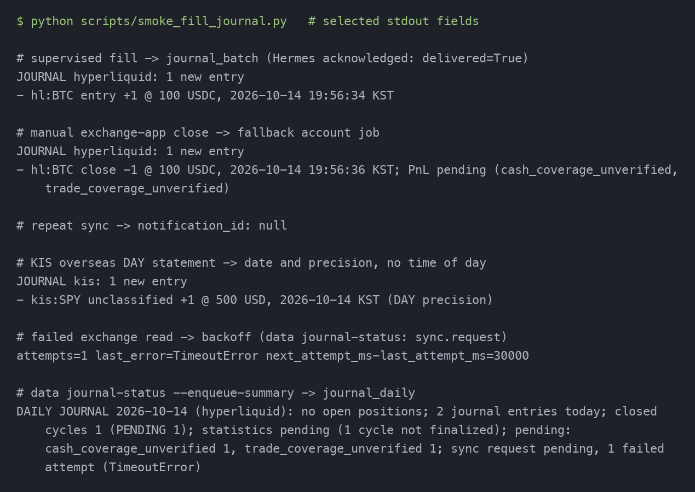

# Fill-triggered journals, notifications and journal status

This manual uses the offline smoke, not account data or live orders. The PNG shows
selected fields from the actual stdout of `python scripts/smoke_fill_journal.py`. That
script drives an in-process supervisor and then real CLI processes against a temporary
SQLite file, with exchange reads served from a local fills file and sockets blocked.

## Before you start

- Supervisors (`supervisor run`) and the worker (`market collect`) use the **same**
  absolute `--db` path.
- One `account` job per account: Hyperliquid every 300 s and KIS every 3,600 s. Example
  job JSON: `{"kind":"account","venue":"hyperliquid","account":"ACTUAL_SUBACCOUNT","start_ms":VERIFIED_START}`.
- `market collect --poll-seconds 30` is running. Installing it as a host service is a
  separately approved cutover step; nothing here starts it.

## A supervised fill (scenario S1)

When a live supervisor observes a fill, it commits its own state and then records one
sync request. On its next pass, `market collect` syncs that account from 15 minutes
before the supervisor's previous observation and writes the journal. It then queues
one `journal_batch` notification. Hermes reads and acknowledges it:

```bash
python -m kis_hl.cli supervisor notifications --venue hyperliquid
python -m kis_hl.cli supervisor notification-result --venue hyperliquid \
    --notification-id ID --result delivered
```

Each line shows the instrument, change type, signed quantity, price, KST time and
source precision. A cycle-closing line shows realized PnL only when the cycle is
finalized; otherwise it says `PnL pending (reasons)`. Routine syncs leave HL cash
coverage and KIS trade coverage unverified, so pending is the normal result until
coverage is certified.



## Manual trades and repeats (scenario S2)

A trade placed in the exchange app has no supervisor. The account job picks it up
within its interval: 5 minutes for HL, 60 minutes for KIS. Syncing the same range again
(for example `data sync` for an audit) adds no journal and no notification. In the
smoke, the repeat sync returned `notification_id: null`.

## KIS DAY precision (scenario S4)

KIS statements (domestic and overseas) are daily and cumulative. Their lines show
the KST date and `(DAY precision)`, never an invented time of day. The capture
above includes an overseas DAY statement synced through `data sync --venue kis`.

## When a sync fails (scenario S3)

A failed exchange read never touches protection or orders. The request stays pending
and records `attempts` and `last_error` (the exception type only), then retries after
30 s, 60 s and so on, up to 15 minutes, until a success clears it. Check it with:

```bash
python -m kis_hl.cli data journal-status
```

The `sync` part shows the request, the last sync (success or partial, with the unresolved
source buckets), the account jobs, the last failed collection and the worker heartbeat
(`worker_last_seen_ms`). An incomplete KIS collection keeps the previous success time and
lists its unresolved buckets. A job without an explicit account appears under
`unattributed_jobs` when its venue has more than one account. If requests stay pending and the
heartbeat is old, the worker is not running.

## Daily summary (scenario S5)

`data journal-status` never changes database content. For a WAL database, SQLite may
create its standard empty `-wal`/`-shm` sidecar files, exactly as `data status` does.
After the US close, Hermes runs:

```bash
python -m kis_hl.cli data journal-status --enqueue-summary
```

This queues one `journal_daily` notification per account and KST date. Running it again
on the same date queues nothing. The summary lists open positions, today's entries,
closed cycles, and the nine statistics: finalized cycles only, otherwise "statistics
pending" with the count. It also lists pending reasons and sync health. Delivery is at
least once, so a crash between sending and `notification-result` can repeat a message.

See [the sync policy](../../unified-data-operations.md#current-operating-policy-fill-triggered-sync-with-a-fallback-interval-58).
