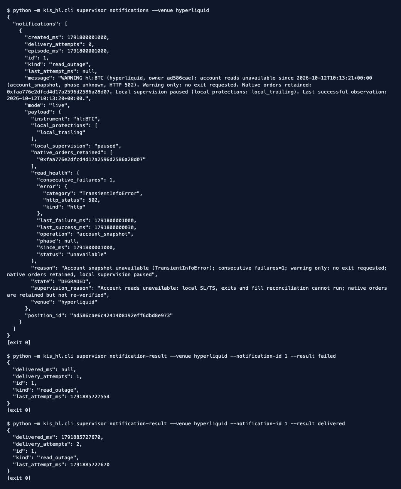
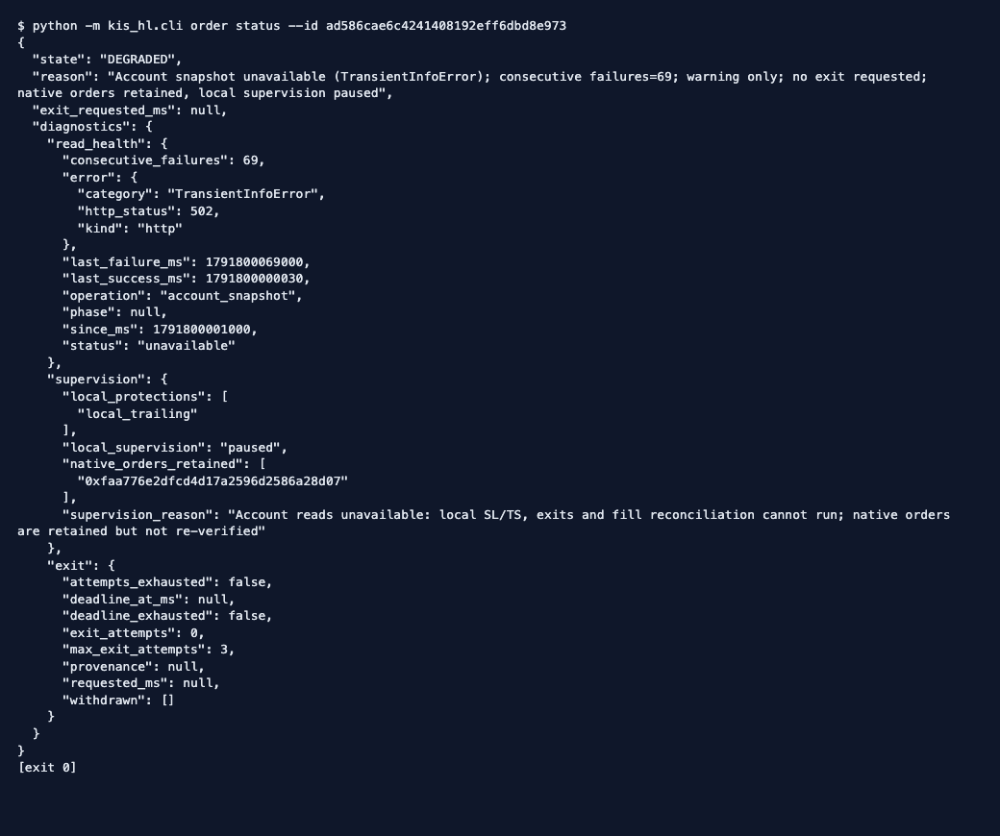
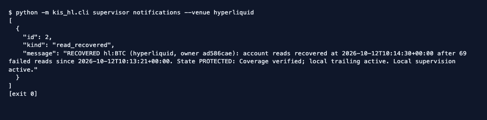
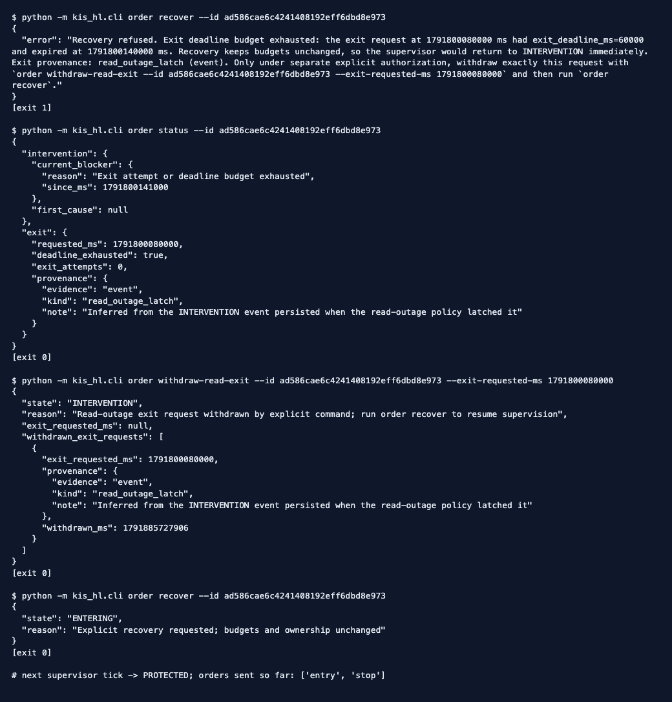

# Account-read outages: operator manual

An account-read failure is a warning, never a sell signal (AK, 2026-10-09). The
managed supervisor keeps the native SL/TS orders at the venue and pauses local
supervision. It records one warning, keeps reading on every poll, and resumes the
same authorized protection once a fresh, consistent readback arrives. This manual
covers the operator commands only. The policy itself is described in
[read outages and recovery limits](../trading-operations.md#read-outages-and-recovery-limits).

The screenshots below are actual output from `kis_hl.cli`. They were produced
against a temporary SQLite database driven by the offline scripted supervisor in
`scripts/smoke_read_outage.py`, using synthetic timestamps. No network,
credentials, signed action or `--live` flag was used, and no live outage was
exercised.

## 1. Deliver the outage warning (S3)

Hermes runs the listing on its own schedule. It delivers each `message`, then
reports the outcome. Listing is read-only. A `failed` result leaves the row
pending and records the attempt, so the next run retries it. Notification
handling never changes positions, exits or orders.

```bash
python -m kis_hl.cli supervisor notifications --venue hyperliquid
python -m kis_hl.cli supervisor notification-result --venue hyperliquid --notification-id ID --result failed
python -m kis_hl.cli supervisor notification-result --venue hyperliquid --notification-id ID --result delivered
```



Each owner gets exactly one `read_outage` row per episode, however many polls
fail and even across restarts. Messages and payloads omit the account scope and
any transport text. They report only the allowlisted error class, kind and HTTP
status.

## 2. Read the degraded owner during the outage (S1, S4)

```bash
python -m kis_hl.cli order status --id POSITION_ID
```



Check four things:

- `exit_requested_ms` stays `null`;
- `read_health` names the failing operation, phase and classification;
- `supervision.native_orders_retained` lists the owned venue orders, which stay
  in place but cannot be re-verified while reads fail;
- `local_supervision` is `paused`.

While reads fail, local SL/TS cannot act. That is the accepted risk of the
warning-only policy.

## 3. Confirm recovery (S1, S3)

On the first fresh, consistent readback the owner returns to its authorized
protection without new SL/TS orders, and one `read_recovered` notice is recorded.



If the notice reports `INTERVENTION`, the reads recovered but reconciliation
found an identity, ownership or evidence problem. That problem still needs
manual reconciliation.

## 4. Resolve a legacy read-outage latch (S5)

Code before issue 59 could latch an exit during a read outage. Once its deadline
passed, the owner stayed in `INTERVENTION`. `order recover` now refuses such an
owner and explains why. Every step after that requires separate, explicit
authorization for that exact owner.



1. Run `order status --id ID`. Confirm that `exit.provenance.kind` is
   `read_outage_latch`, that `exit_attempts` is 0, and that
   `intervention.current_blocker` holds the deadline blocker.
2. Run `order withdraw-read-exit --id ID --exit-requested-ms EXACT_MS`. The
   command refuses a wrong time, any other provenance, an existing exit attempt,
   an UNKNOWN or unresolved entry/add, a recorded protective fill, or a pending
   entry cancellation. It never renews a budget and never sends an order.
3. Run `order recover --id ID`. The next supervisor tick reconciles with
   unchanged budgets. In the example it returns to `PROTECTED` with no new orders.

If any check fails, manage the residual position under a separately authorized
procedure. Never edit SQLite.
